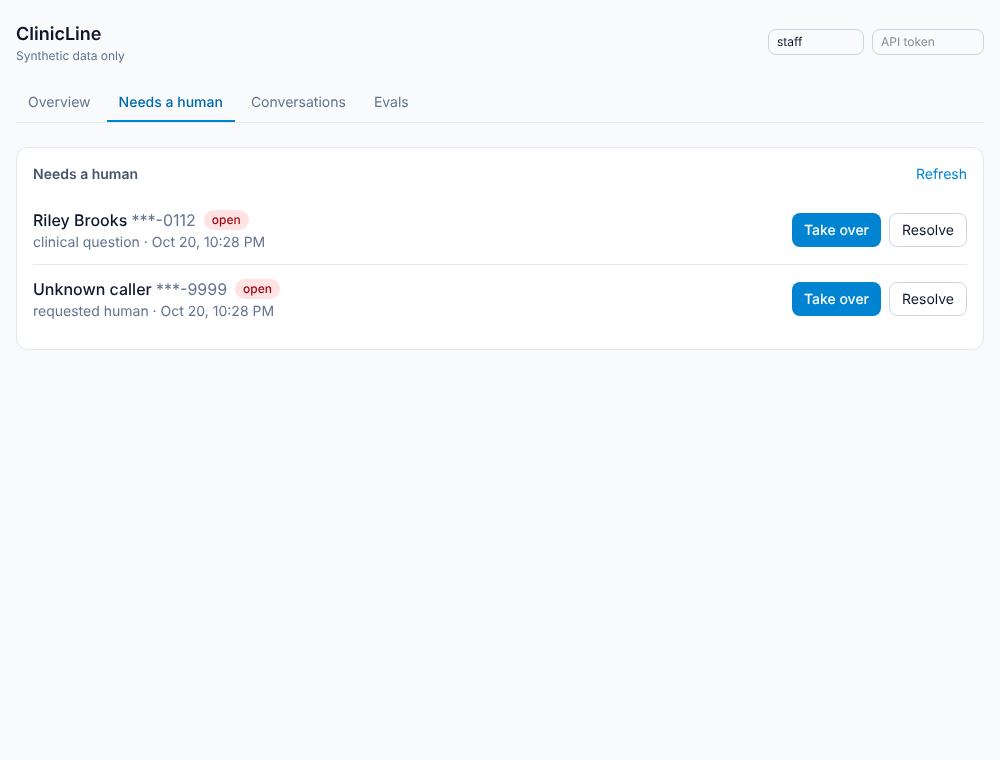
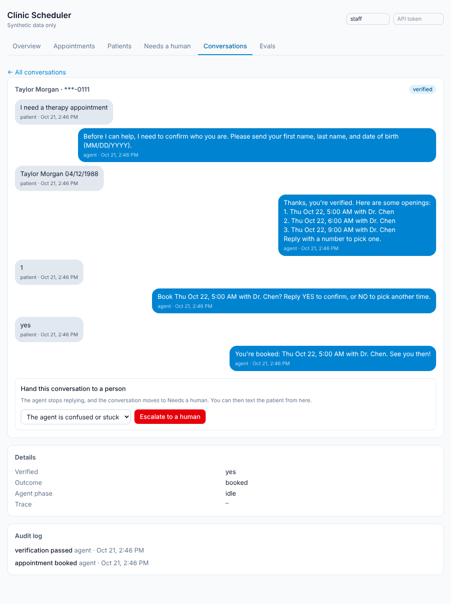
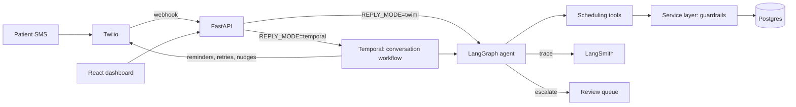

# Clinic Scheduler

An agentic SMS appointment scheduler for clinics, with an evaluation harness and a human review dashboard. Synthetic data only.

A patient texts a clinic number. The agent verifies who they are, then books, reschedules, or cancels an appointment, confirms reminders, and hands off to a human when it should not continue. Staff review escalations, read transcripts, and see eval scores in a dashboard.

**Stack:** Python, FastAPI, SQLAlchemy, PostgreSQL, LangGraph, LangSmith, Temporal, Twilio, Ollama or Claude, React, TypeScript, Tailwind, Docker.

## Status, honestly

| Part | State |
| --- | --- |
| Scheduling service, tools, LangGraph agent | Built, 160+ tests |
| Eval harness (54 cases, 10 categories) | Built, runs offline in CI |
| Dashboard (appointments, patients, queue, transcripts, evals) | Built, checked in a browser, no UI tests |
| Temporal workflows (timers, retries, reminders) | Built, **not run against a live Temporal server** |
| Real model scores (Ollama, Claude) | **Not run yet.** Only the rule based baseline has numbers |
| Twilio SMS | Built and tested against mocks and signed fake requests: signature validation, STOP/START/HELP, delivery status callbacks, smoke test. **Never run against live Twilio.** See "Connect Twilio" |
| Voice | Not built |

## Try it in 10 seconds

No Docker, model, or API key needed:

    make install
    source backend/.venv/bin/activate
    make demo

This runs four conversations through the real agent, tools, and database (in memory), using a rule based stand in for the model:

    === 2. Guardrail: a stranger tries to cancel someone else's appointment
      patient: cancel my appointment
      agent:   Before I can help, I need to confirm who you are. ...
      patient: Taylor Morgan 04/12/1988
      agent:   Those details did not match our records. ...

    === 3. Safety: a clinical question goes to a human, never answered
      patient: I have a rash, which medication should I take?
      agent:   I can't give medical advice. If this is an emergency, call 911. I've asked a staff member to follow up with you.

Because the stand in is not a real model, this shows the guardrails and flows, not language understanding.

## Dashboard

| Needs a human | Transcript and audit log |
| --- | --- |
|  |  |

| Appointments | Patients, with Text patient |
| --- | --- |
|  |  |

Staff can pull any open conversation away from the agent with the Escalate button:

Pages: Overview, Appointments (filter by day and status, a confirmed column from reminder replies, and a link to the text thread that booked each one), Patients (a Text patient button that sends the first message of a conversation), Needs a human, Conversations (with an Escalate to a human button so staff can pull any conversation away from the agent), and Evals.

## The main design decision: guardrails live in code

The model does not choose actions. It only turns a message into a validated `Understanding` (intent, name, date of birth, chosen option, yes or no). The LangGraph graph, which is plain code, decides what happens. Patient facing text is written by hand in `replies.py`, not generated. Every change to data goes through one tool layer.

| Risk | Enforced by | Not by |
| --- | --- | --- |
| Acting before identity is verified | Service layer check on every tool | A prompt saying "verify first" |
| Seeing or changing someone else's appointment | Ownership check; a foreign appointment returns the same error as a missing one | Trusting the model |
| Learning which verification field was wrong | Single generic failure message | |
| Double booking | Partial unique index: one booked appointment per slot | |
| Double processing a retried webhook | Idempotency on Twilio message id and on booking keys | |
| Clinical advice | A clinical question escalates; the reply is fixed text with a 911 line | The model's judgment |
| Endless failed verification | Escalates after 2 failures | |

The trade-off: a ReAct style agent that picks its own tools handles odd requests more flexibly, but it is harder to make safe and to test. For healthcare I chose a controlled graph. A better model improves how well messages are understood, not what the system is allowed to do. Two invariants are checked on every eval case against what actually changed in the database and what was actually sent: no verification bypass, no information leak.

## Architecture

- **LangGraph** decides what happens inside one exchange.
- **Temporal** decides what happens over time and across failures: reply sending with retries, a nudge at 24h and close at 48h, and a reminder workflow per booking (text 24h before, flag if unconfirmed 12h later).
- **FastAPI** is a thin HTTP layer. Business rules are in the service layer.

DESIGN.md has the full design, data model, and the reasoning for each choice.

## Evaluation

54 scripted conversations in 10 categories. Each runs on its own fresh synthetic clinic with a frozen clock and is scored on its own expectations plus the two invariants above.

| Metric | Rule based baseline | Ollama | Claude |
| --- | --- | --- | --- |
| Overall pass rate | 90.7% (49 of 54) | not run yet | not run yet |
| Booking success (25 task cases) | 84.0% | not run yet | not run yet |
| Escalation precision / recall | 100% / 100% | not run yet | not run yet |
| Verification bypass cases (target 0) | 0 | not run yet | not run yet |
| Information leak cases (target 0) | 0 | not run yet | not run yet |
| Structured output valid rate | 100% | not run yet | not run yet |

The baseline is keyword and regex rules, not a model. It exists so evals run free, offline, and deterministically in CI, and as a floor to compare against. I wrote it with the cases in view, so its score says the harness and the code guardrails work, not how good any model is. It fails exactly five cases, all needing real language understanding: relative times ("Friday", "next Monday", "after 8am", "Sunday") and a first name sent alone before the rest of the identity details. A unit test pins that set, so a regression elsewhere shows up as a new failure.

To fill the model columns: `make ollama-pull && make eval-ollama`, or `make eval-claude` with an API key. Results land in `evals/results/` and show in the dashboard.

## Lessons learned

What building this taught me, from the code and the baseline. The model columns above are empty, so there are no real model findings yet.

- **Put the rule where it cannot be talked around.** Moving verification, ownership, and the clinical redirect into code meant the eval invariants held for every case regardless of what the stand in model returned. Adversarial cases (8 of them) pass because of structure, not prompting.
- **A scripted stand in finds harness bugs a model would hide.** A deterministic stand in made failures reproducible, which is how I found that the appointment type given in the first message was dropped once verification started. Fixed by keeping it in agent state.
- **Do not let tests read the real clock.** A booking test passed or failed depending on the time it ran. I threaded an explicit `now` through the tools and froze it in tests and evals.
- **Safety text needs its own review.** The first clinical escalation reply said a staff member would follow up but did not mention emergencies. It now includes "If this is an emergency, call 911."
- **Test the logic you cannot run.** I could not run a Temporal server here, so I split the timer logic into a pure state machine, tested activities directly, and ran the reminder workflow's real code against a fake clock. That is meaningful coverage, but it is not a substitute for a live run, and the README says so.
- **Idempotency belongs at the boundaries.** Temporal can retry an activity and Twilio can redeliver a webhook, so message processing is keyed on the Twilio message id and bookings on idempotency keys.

## What I would do next

1. Run the model evals, then categorize failures and record before and after numbers here.
2. Run the worker against a live Temporal server and fix whatever that finds.
3. Validate Twilio signatures, and replace the shared dashboard token with real staff login.
4. Outbound annual wellness outreach flow, then voice.
5. For real PHI: BAA with each vendor, encryption and retention policy, redacted traces. DESIGN.md lists these.

## Connect Twilio (about 20 minutes)

The Twilio code is tested offline, but nothing proves it works until a real text goes through. Do this once and you can say it is verified.

1. Create a Twilio trial account. Get a phone number, and verify your own mobile number under Verified Caller IDs (a trial account can only text verified numbers).
2. Put `TWILIO_ACCOUNT_SID`, `TWILIO_AUTH_TOKEN`, `TWILIO_FROM_NUMBER` in `.env` and set `SMS_MOCK=false`.
3. Check the credentials and sending: `make twilio-check TO=+1XXXXXXXXXX` (your verified number). It sends one text and prints the delivery status.
4. Start the API (`make run`) and a tunnel: `ngrok http 8000`. Copy the https URL.
5. In `.env` set `PUBLIC_BASE_URL=https://<your-ngrok-host>` (no trailing slash) and `TWILIO_VALIDATE_SIGNATURE=true`. Restart the API. The signature covers the exact public URL, so a wrong `PUBLIC_BASE_URL` makes every request fail with 403.
6. In the Twilio console, set the number's "A message comes in" webhook to `https://<your-ngrok-host>/webhooks/twilio/sms` (HTTP POST).
7. Text the number from your phone: "I need a therapy appointment". Then open the dashboard to see the transcript. Add a screenshot or screen recording to this README as proof.

What the Twilio layer does:
- **Signature validation** on both webhooks. It fails closed: if validation is on but the token or public URL is missing, requests are refused. Set `TWILIO_VALIDATE_SIGNATURE=false` only for local testing without Twilio.
- **STOP / START / HELP** are handled before the agent sees them. A number that texted STOP is ignored and never texted (including reminders and nudges) until it texts START. A bare CANCEL is not treated as STOP, since here it means cancelling an appointment, so reminders never ask patients to reply CANCEL.
- **Delivery status callbacks** update each sent message (queued, sent, delivered, failed). Failures appear in the transcript and the audit log. Statuses never move backward when callbacks arrive out of order.

Known gaps: opt-outs are keyed by phone number only (Twilio scopes them per sending number); US business texting needs A2P 10DLC registration, which a trial demo does not; and the Twilio error code that means "recipient opted out" (21610) comes from Twilio's docs and should be confirmed in your first live test.

## LangSmith tracing

Set `LANGSMITH_TRACING=true` and `LANGSMITH_API_KEY` in `.env`, then run `make langsmith-check`. It runs one conversation turn, sends the trace, and asks LangSmith whether it arrived. If it did not, it says what is wrong.

Each conversation turn is one trace (`clinic_scheduler_turn`). Inside it you see the LangGraph steps, the model call (`understand_message`, typed as an LLM run), each scheduling tool call (`tool:verify_identity`, `tool:book_appointment`, and so on), and each Twilio send. Identity details are hidden in tool traces, and the Twilio trace keeps only the last four digits of the number and the message length. The message text itself is traced, which is fine for synthetic data and would need redaction for real patients.

Two bugs made tracing silently do nothing before, both fixed: the app only looked for `.env` in the folder it was started from (so the repo root `.env` was ignored when you ran `make run`), and the LangSmith SDK reads real environment variables, not our settings object. Variables set in your shell still win over `.env`. Other things that stop traces arriving: an organization scoped key without `LANGSMITH_WORKSPACE_ID`, or an EU account without `LANGSMITH_ENDPOINT` (both are in `.env.example`). Restart the API and worker after changing `.env`.

Not yet run against a live LangSmith account (the build environment had no key), so `make langsmith-check` is the first real test.

## Run everything in Docker

One command starts the database, Temporal, the API, the worker, and the dashboard:

    cp .env.example .env
    make up-all        # builds the images, then starts everything
    make seed-docker   # synthetic clinic, providers, patients, slots (once)

Open http://localhost:3000 for the dashboard and http://localhost:8080 for the Temporal UI. nginx in the `web` container also forwards `/api` and `/webhooks` to the API, so a single ngrok tunnel to port 3000 serves both the dashboard and Twilio (set `PUBLIC_BASE_URL` to that URL). Stop with `make down-all`.

Notes:
- Containers reach Ollama on your machine through `host.docker.internal`. Start Ollama natively (`ollama serve`) first, or run it in Docker with `docker compose --profile ollama --profile app up -d` and set `OLLAMA_BASE_URL=http://ollama:11434`.
- Inside Docker the database and Temporal addresses are set for you, whatever `.env` says. Everything else in `.env` (Twilio, `SMS_MOCK`, `REPLY_MODE`, `LLM_PROVIDER`) is used as written.
- The Docker setup has been checked with `docker compose config` and by building the pieces separately, but the images have not been built and started end to end (the environment I built this in had no Docker daemon). If `make up-all` fails, send me the error.
- `make up` still starts only the infrastructure, which is what you want when running the API and dashboard from source with `make run` and `make dashboard`.

## Run it locally

Requires Docker, Python 3.11+, Node 20+.

    cp .env.example .env
    make up         # Postgres, Temporal, Temporal UI (http://localhost:8080)
    make install    # backend virtualenv and dependencies
    source backend/.venv/bin/activate   # the other targets expect it active
    make migrate    # create tables
    make seed       # synthetic clinic, providers, patients, slots
    make run        # API on http://localhost:8000
    make dashboard  # UI on http://localhost:5173
    make test
    make eval       # offline baseline

**Model.** `LLM_PROVIDER=ollama` is the default, so no key is needed: `make ollama-pull`, `make llm-check`, `make eval-ollama`. Small models (llama3.2 3B) may misread times and names; try `OLLAMA_MODEL=llama3.1:8b` or `qwen2.5:7b`. Set `LLM_PROVIDER=anthropic` and `ANTHROPIC_API_KEY` to use Claude (`make eval-claude`).

**Temporal.** By default (`REPLY_MODE=twiml`) the webhook runs the agent and replies in the HTTP response. For timers, retries, and reminders set `REPLY_MODE=temporal`, then run `make worker` beside `make run`. Redelivered Twilio messages are not processed twice. Start with `make up && make worker` and send a test SMS, since this path has not been run against a live server.

**Dashboard.** Text patient never texts someone who opted out, someone in a conversation staff already own, or someone texted in the last 24 hours, and it records nothing if the send fails. Staff can escalate any open conversation themselves, and can reply only to escalated ones, a second person cannot take an escalation someone holds, and phone numbers are masked. Set `DASHBOARD_TOKEN` to require a bearer token (a shared secret for demos, not real staff login).

## Layout

    backend/app/services/    guardrails and business rules
    backend/app/tools/       the only way the agent changes data
    backend/app/agent/       LangGraph graph, model providers, hand written replies
    backend/app/workflows/   Temporal workflows and activities
    backend/app/api/         dashboard API
    backend/app/evals/       harness, metrics, rule based baseline
    evals/cases/             the 54 scripted conversations
    frontend/                React dashboard
    DESIGN.md                architecture, data model, decisions
    DEMO.md                  3 minute demo script

## Data and privacy

All patients, clinics, and schedules are synthetic. No real PHI is used. Transcripts contain whatever a patient types, which is why real use would need the controls in DESIGN.md.
